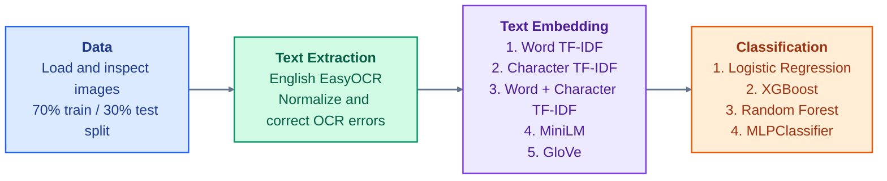
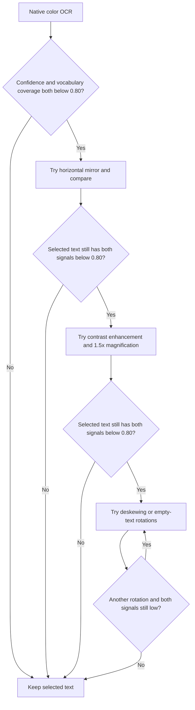
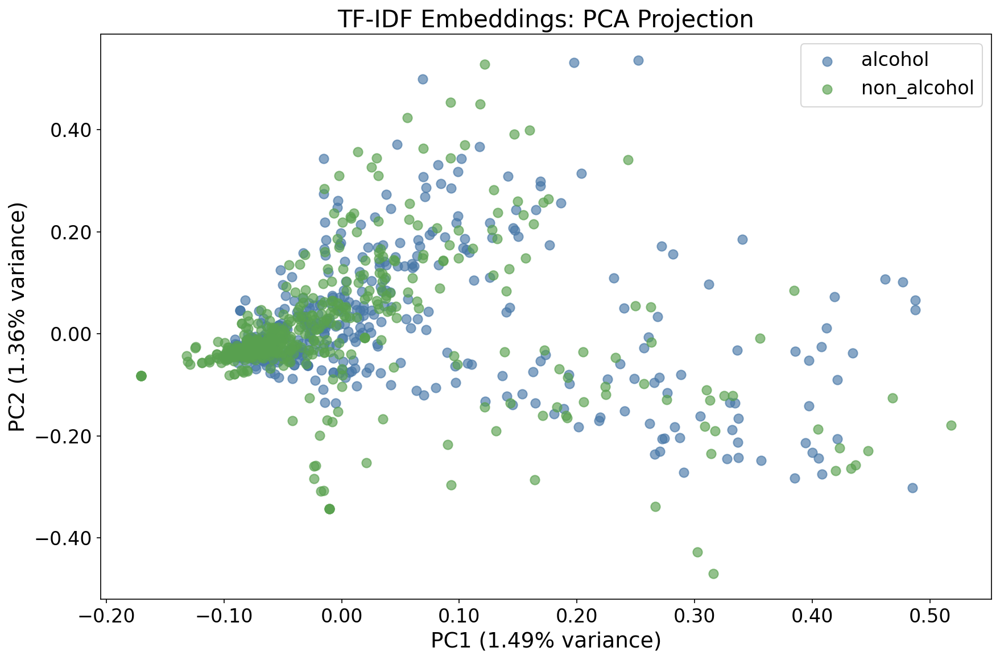
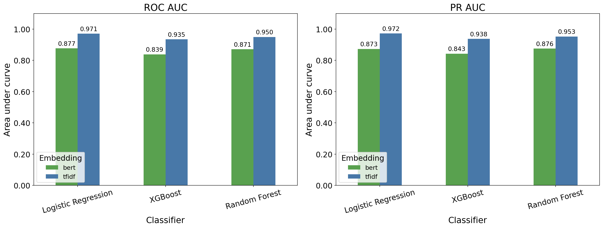
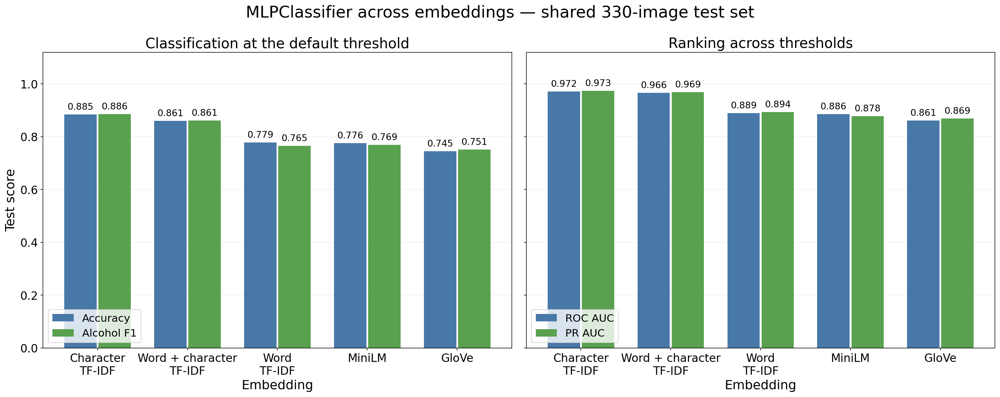
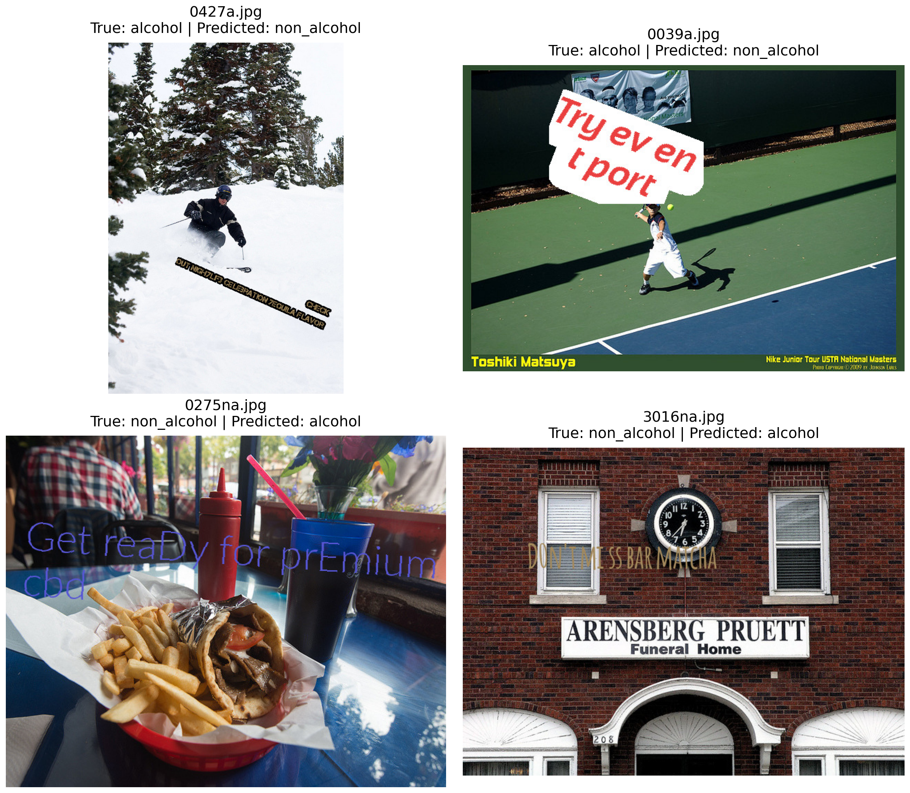

# Photo Text Alcohol Classifier

Classify images as `alcohol` or `non_alcohol` based on the text they contain.
The pipeline extracts text from images, extract text using OCR, clean text, converts text into
numeric features, and trains classifiers. All models run on the CPU.

This project follows the instactions in [DV DS CV + NLP assignment](<DV DS home assignment - CV+NLP.pdf>).
The main code is in [image_text_alcohol_classification.ipynb](src/image_text_alcohol_classification.ipynb).  
[alcohol_lists.py](src/alcohol_lists.py) supplies alcohol brands and drinks vocabulary for
OCR scoring and cleaning.  

## How to run

Use **Python 3.10 on Linux**. From the repository root, create an environment,
install the pinned dependencies, and open the notebook:

```bash
python3.10 -m venv .venv
source .venv/bin/activate
python -m pip install -r requirements.txt
python -m notebook src/image_text_alcohol_classification.ipynb
```

Select the environment's Python kernel and run the cells from top to bottom.
The notebook resolves paths when its working directory is either the repository
root or `src/`. The requirements include CPU-only PyTorch packages.

Place the dataset in these folders, using the exact lowercase names:

```text
images/
├── alcohol/
│   └── <image files>
└── non_alcohol/
    └── <image files>
```

The loader reads JPG, JPEG, PNG, BMP, TIF, and TIFF files directly inside each
class folder. The folder name is the training label.

The first notebook cell controls which dataset runs:

| Setting | Input folder | Output folder |
| --- | --- | --- |
| `test_mode = False` (default) | `images/` | `results/` |
| `test_mode = True` | `test/images_test/` | `test/results_test/` |

Test mode requires the same `alcohol/` and `non_alcohol/` subfolders. It checks
the workflow with a smaller dataset. 

Internet access is needed for package installation and the first downloads of
EasyOCR, MiniLM, and GloVe weights. Later runs reuse the model caches in `.cache/`.

### Standalone inference

The notebook's final step saves the winning classifier to `results/best_cls.joblib`
and its fitted text representation to `results/best_vectorizer.joblib`.
Use these artifacts to classify a directory of unlabeled images on the CPU:

```bash
source .venv/bin/activate
python src/inference.py /path/to/images --output results/results.csv
```

The script reads supported image files directly inside the input directory,
applies the same OCR and cleaning as the notebook, and predicts without training.
It writes `file_name,prediction`, using `alcohol` or `non_alcohol` for each image.
Use `--model-dir /path/to/artifacts` to load artifacts from another directory,
or `--output results/new_predictions.csv` to save a separate prediction file.
An empty directory produces a CSV containing only the column headers.

## Pipeline

### Pipeline overview



### Step 1: Load Data

Creates one row per image with its filename, path, label,
dimensions, format, color mode, and file size. Dimensions account for the
image's EXIF orientation metadata.

Create one stratified **70% train / 30% test** split with `random_state=42`
before OCR and embeddings. Use the same split throughout: fit TF-IDF and train
classifiers on the 70%, then evaluate on the 30%. No cross-validation.

### Step 2: Text Extraction

#### OCR

Use one English EasyOCR reader on the CPU, with recognition batch size 8.
Start with the EXIF-oriented, native-size color image and join detected text
in reading order.

Retry only while **both character-weighted confidence and vocabulary coverage
are below `0.80`**. Coverage uses CMUdict plus beverage and brand terms.
Try a horizontal mirror, then contrast-enhanced grayscale with **1.5× detection
magnification**. If both signals remain low, deskew tilted text or try −30° and
+30° rotations for empty text. Enhanced attempts also test 180° text-box rotation.



Accept a retry only when its weighted confidence/coverage score improves by
more than `0.05` and it retains at least 80% of recognized words. 
Save selected text, boxes, and attempt diagnostics to `results/ocr/ocr_text.csv`.  
Reuse cached results when images, vocabulary, settings, and pipeline version match.

#### Text Cleaning

Preserve `extracted_text` and add `cleaned_text` for the downstream models:

1. Normalize Unicode with NFKC, lowercase text, standardize apostrophes, then
   collapse repeated whitespace and trim leading/trailing spaces.
2. Correct unknown word tokens against the English and beverage vocabulary.
   Use weighted edit distance, with lower costs for OCR confusions such as
   `0`/`o` and `i`/`l`. 


Save `ocr_text_cleaned.csv`, correction counts, summaries, and a correction plot
in `results/ocr/`. 
Cleaning runs whenever its cells execute, even when OCR is cached. 

### Step 3: Text Embedding

An embedding represents each image's cleaned text as a numeric vector that a
classifier can use. Compare five representations to cover exact words, partial
words, and semantic meaning.

#### Prepare Text

Use `cleaned_text` as source. 

#### TF-IDF

Each image's cleaned OCR text is one **document**, used to classify the image
as `alcohol` or `non_alcohol` **topic**. TF-IDF weights terms by their frequency in that
document and rarity across documents. **Word TF-IDF** captures individual words
and two-word phrases, but OCR spelling errors
can break these matches. **Character TF-IDF** captures 3–5-character fragments
within word boundaries, retaining useful parts of misspelled words.
**Word + Character TF-IDF** combines both feature sets so classifiers can use
intact words and phrases alongside fragments that survive OCR errors.
Save artifacts in `results/embeddings/tfidf_<type>/`.

#### MiniLM

Use the pretrained `sentence-transformers/all-MiniLM-L6-v2` model at a pinned
revision to produce 384-dimensional sentence vectors on the CPU. This adds a
representation of meaning beyond exact term matches. Normalize nonempty
vectors and record texts that exceed the model's token limit and are truncated.
Save artifacts in `results/embeddings/bert/`.

#### GloVe

Use pretrained `glove-wiki-gigaword-100` word vectors. Average the known words
in each image's text into a 100-dimensional vector and L2-normalize it. Skip
unknown words, text with no known words stays zero. Record vocabulary coverage
to show how much text contributes. Averaging loses word order. 
Save artifacts in `results/embeddings/glove/`.

#### Compare Embeddings

Use two-dimensional PCA plots to inspect each representation. 
PCA reduces the vectors to two coordinates for visualization, classification uses the original features.

Compare cosine silhouette scores using the same images across all five methods,
excluding any image with a zero vector in any method. The score describes how
well the two labeled classes separate in feature space to test embbedind proformance. 

### Classification

#### Preparations

Reuse the shared split and existing embeddings without refitting vectorizers
or encoding text again. Encode `alcohol` as `1` and `non_alcohol` as `0`.


#### Logistic Regression

Train a linear baseline with up to 1,000 iterations. 

#### XGBoost

Train 200 sequential boosted trees with maximum depth 3 and learning rate `0.05`.


#### Random Forest

Train 200 trees and combine their predictions. Require at least two training
images per leaf to limit very specific rules.

#### MLPClassifier

Train a neural network with one 64-unit ReLU hidden layer, Adam optimization,
and L2 regularization. Train each classifier once per embedding on the shared
training split and evaluate on the shared test split, without cross-validation.

#### Performance Comparison

Evaluate every classifier with every embedding: **20 combinations**. The code
computes the following metrics; measured values appear in the Results section.

| Metric | What it assesses |
| --- | --- |
| Accuracy | Fraction of all test images classified correctly. |
| Alcohol precision | How often an alcohol prediction is correct. |
| Alcohol recall | How many actual alcohol images are detected. |
| Alcohol F1 | Balance between alcohol precision and recall. |
| Macro F1 | Average F1 across both classes, with equal class weight. |
| ROC AUC | Ranking quality across true-positive and false-positive rates. |
| PR AUC | Area under the precision–recall curve, computed using trapezoids. |

Also save per-class precision, recall, F1, and support (the number of examples).
AUC metrics use alcohol probabilities. All metrics use the same held-out test
images.

Each classifier has a folder under `results/classification/`, containing
per-embedding reports, test predictions, fitted models, and ROC/PR curves. The
combined table is `performance_comparison.csv`. 

#### Output

Select the classifier and embedding with the highest test PR AUC, breaking ties
by ROC AUC. Use that trained model to predict every input image, without
refitting it. TF-IDF inputs use its training-fitted vectorizers; combined
features retain word columns first and character columns second. Reuse the
existing embedding matrices for this export.

Write `results/results.csv` with the assignment's required columns:
`file_name,prediction`. Each prediction is `alcohol` or `non_alcohol`, matching
the format in [example_results.csv](results/example_results.csv). 

Also save the selected model as `results/best_cls.joblib` and its text
representation as `results/best_vectorizer.joblib` for standalone inference.


## Results

The saved run uses **1,100 images**, evenly split between the two classes:
**770 training / 330 test**, with 165 images per class in the test set.
OCR found text in **1,083 images (98.45%)**; cleaning corrected 181 tokens.

### Embedding Results

Silhouette scores use the same **979 images with nonzero vectors in every
method**. Higher scores mean better class separation; values near zero indicate
overlap. PCA variance is the percentage retained by the first two components.

| Embedding | Dimensions | Cosine silhouette | PCA variance (PC1 + PC2) | PCA plot |
| --- | ---: | ---: | ---: | --- |
| MiniLM | 384 | 0.0174 | 10.47% | [View](results/embeddings/bert/bert_pca.png) |
| GloVe | 100 | 0.0156 | 27.38% | [View](results/embeddings/glove/glove_pca.png) |
| Character TF-IDF | 5,000 | 0.0128 | 3.58% | [View](results/embeddings/tfidf/tfidf_pca.png) |
| Word + Character TF-IDF | 8,861 | 0.0092 | 3.13% | [View](results/embeddings/combined_tfidf/combined_tfidf_pca.png) |
| Word TF-IDF | 3,861 | 0.0057 | 3.31% | [View](results/embeddings/word_tfidf/word_tfidf_pca.png) |



The classes overlap in this projection, which retains only **3.58%** of the
variance. These are exploratory results across the dataset; classifiers use
the full embedding vectors, and their test scores below measure prediction quality.

### Classification Results

The table shows each classifier's best embedding by test PR AUC—all four chose
**character TF-IDF**. Precision, recall, and F1 refer to the alcohol class.

| Classifier | Accuracy | Precision | Recall | F1 | Macro F1 | ROC AUC | PR AUC |
| --- | ---: | ---: | ---: | ---: | ---: | ---: | ---: |
| MLPClassifier | 88.48% | 0.880 | 0.891 | 0.886 | 0.885 | 0.9717 | 0.9735 |
| Logistic Regression | 87.58% | 0.878 | 0.873 | 0.875 | 0.876 | 0.9708 | 0.9729 |
| Random Forest | 82.42% | 0.820 | 0.830 | 0.825 | 0.824 | 0.9361 | 0.9398 |
| XGBoost | 84.55% | 0.777 | 0.970 | 0.863 | 0.843 | 0.9233 | 0.9123 |



**MLP with character TF-IDF** leads by PR AUC, with logistic regression close
behind. XGBoost detects more alcohol images but makes more false-positive
predictions. MiniLM has the highest silhouette score, while character TF-IDF
performs best in classification.

See [all 20 test results](results/classification/performance_comparison.csv)
and [predictions for all 1,100 images](results/results.csv). The test split also
selects the winning model, so its scores are not a separate final evaluation.

## Discussion

### Overview

This task combines several challenges: unclear photographs, inconsistent text
orientation, OCR errors, and short text fragments. Each stage affects the next,
so classification depends on both readable text and a suitable representation.

The workflow addresses these issues through selective OCR retries,
vocabulary-based text cleaning, and comparison of five embeddings with four
classifiers. One shared stratified **70/30 split** keeps training and evaluation
consistent.

### OCR

Some photographs contain blurred, low-contrast, rotated, or mirrored text.
Mirror retries supplied the selected transcription for **170 images**, showing
the value of checking orientation. OCR text was evaluated manually and through
Codex-assisted review using **GPT-6.1 Sol**. These qualitative checks help identify
errors; OCR confidence and dictionary coverage remain heuristics rather than
measured transcription accuracy. Misspelled brands and missing words can remove
useful classification signals, and **17 images** still had no extracted text.

To improve extraction, the pipeline tries mirroring, contrast enhancement,
increased detection magnification, and deskewing when confidence and vocabulary
coverage are both low. It keeps retries only when their quality score improves.
Text cleaning normalizes case and spacing and corrects unknown words using
an English and beverage vocabulary. **Topic-specific knowledge** comes from the
alcohol brand and drink lists in [alcohol_lists.py](src/alcohol_lists.py).
These terms support vocabulary-based OCR scoring and spelling correction,
helping preserve names that a general English dictionary may miss. Matching
OCR results are cached for reuse.

### Embedding 

**Character TF-IDF performs best across all four classifiers.** A plausible
explanation is that alcohol/non-alcohol classification relies heavily on topic
cues such as drink and brand names. TF-IDF preserves these terms, while character
fragments retain useful parts of OCR-damaged words. MiniLM's contextual strengths
may contribute less when the input consists of short, noisy fragments with
little sentence context.

The [intermediate results](#embedding-results) combine **visual assessment with
PCA plots** and **quantitative assessment with cosine silhouette scores and
explained variance**. Silhouette measures class separation in the full feature
space; scores range from **0.0057 to 0.0174**, with MiniLM highest. Together with
the overlapping PCA plots, these scores suggest weak global separation,
consistent with difficult photographs and noisy text. Explained variance helps
interpret the plots: the first two character TF-IDF components retain only
**3.58%** of the variance. Useful predictive features can still exist within
overlapping representations, as the test results demonstrate.

To handle damaged words, the comparison includes **3–5-character fragments**
and combined word/character features alongside pretrained MiniLM and GloVe.
TF-IDF vocabularies are fitted only on training text, and vectors are
L2-normalized. PCA is used for visualization; classifiers retain the full
features to preserve information lost in the projection.

### Classifiers

MLP and logistic regression lead on character TF-IDF, with PR AUCs of **0.9735**
and **0.9729**. Adding word features lowers both models' accuracy. Rankings also
depend on the embedding: with MiniLM, logistic regression has higher accuracy
than MLP (**80.30% vs. 77.58%**), while random forest has the highest PR AUC
(**0.9028**). Greater model complexity therefore brings no consistent advantage.

Each classifier was trained once per embedding on the same training rows and
evaluated on the same test rows. MLP uses L2 regularization, and random forest
requires at least two images per leaf to limit overfitting. Models are compared
using all seven metrics and selected by PR AUC, with ROC AUC breaking ties.



For MLP, character TF-IDF reaches **88.48% accuracy**, compared with **77.58%**
for MiniLM and **74.55%** for GloVe. The combined TF-IDF representation stays
close in PR AUC (**0.9689**) but reduces accuracy to **86.06%**.

Accuracy is easy to interpret on this balanced test set. Alcohol precision
measures false alarms, **recall** measures how many alcohol images are detected,
and F1 balances the two. Macro F1 gives both classes equal weight. These metrics
reveal trade-offs: XGBoost with character TF-IDF has **0.970 recall** but only
**0.777 precision**, whereas MLP offers a more balanced result.

Depending on the use case, **Recall can be critical**. When the goal is to remove
alcohol-related photographs, missed alcohol images remain in the collection.
A removal workflow may therefore prioritize recall, accepting more false
positives; the decision threshold should reflect that trade-off.

**ROC AUC and PR AUC were chosen because they evaluate performance across
decision thresholds**, without requiring one fixed classification threshold.
ROC AUC compares alcohol detection with the false-positive rate, while PR AUC
focuses on alcohol precision and recall. PR AUC guides model selection, with
ROC AUC breaking ties. 


### Failure Cases

The selected **MLP with character TF-IDF** misclassified **38 of 330 test images**:
**18 false negatives** (missed alcohol images) and **20 false positives**
(non-alcohol images flagged as alcohol). The examples below use the saved
[held-out predictions](results/classification/mlp/tfidf/test_predictions.csv).
True labels come from the dataset folders.



The table shows cleaned OCR text, with excerpts for longer transcriptions.
`P(alcohol)` is the classifier's predicted alcohol probability.

| Image | True label | Prediction | Cleaned OCR text | P(alcohol) |
| --- | --- | --- | --- | ---: |
| [0427a.jpg](images/alcohol/0427a.jpg) | alcohol | non_alcohol | *(no text extracted)* | 0.449 |
| [0039a.jpg](images/alcohol/0039a.jpg) | alcohol | non_alcohol | `try ' tport ev en … toshiki matsuya …` | 0.223 |
| [0275na.jpg](images/non_alcohol/0275na.jpg) | non_alcohol | alcohol | `get read for pprenfium cba` | 0.775 |
| [3016na.jpg](images/non_alcohol/3016na.jpg) | non_alcohol | alcohol | `il iz 33 mss bar mascha arensberg pruett funeral home` | 0.627 |

These cases illustrate different limitations:

- **Missing text - 0427a.jpg:** The image contains small, tilted text mentioning
  “TEQUILA,” but OCR returns an empty string. The classifier therefore receives
  a zero vector. A possible improvement is to detect and enlarge small text
  regions and try a wider range of rotations. Images with no extracted text
  could also be routed for review.
- **Fragmented text and background clutter - 0039a.jpg:** The overlay splits
  “event” across lines beside “port.” OCR merges part of it into `tport` and
  includes unrelated tennis captions. The cleaned text retains this error.
  Better text-box grouping and region-level classification could help preserve
  the alcohol reference while reducing background text. “Port” also needs
  context because it has non-alcohol meanings.
- **Damaged non-alcohol text - 0275na.jpg:** The overlay refers to “premium cbd,”
  while OCR produces `pprenfium cba`. The model still predicts alcohol. This
  suggests that generic promotional wording or overlapping character fragments
  may outweigh the damaged non-alcohol term; the exact feature contribution was
  not measured. More non-alcohol examples with similar promotional wording and
  vocabulary support for terms such as “CBD” could help.
- **Ambiguous wording - 3016na.jpg:** The overlay says “DON'T MISS BAR MATCHA,”
  but OCR reads `bar mascha` and also extracts the funeral-home sign. “Bar”
  alone does not establish an alcohol reference, and the matcha cue is misspelled.
  Context-aware handling of ambiguous terms and better recovery of non-alcohol
  beverage names could reduce this type of false positive.

These proposed improvements would need validation. A threshold change alone
cannot recover an alcohol keyword that OCR never extracted, and increasing
recall may introduce more false positives.
